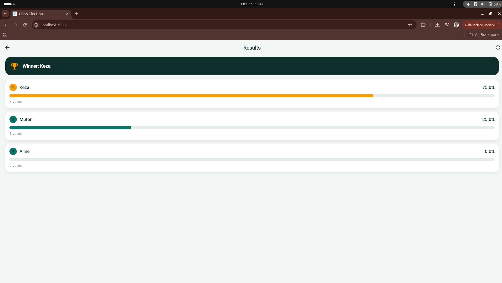
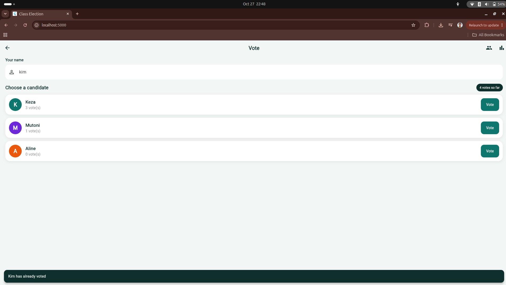
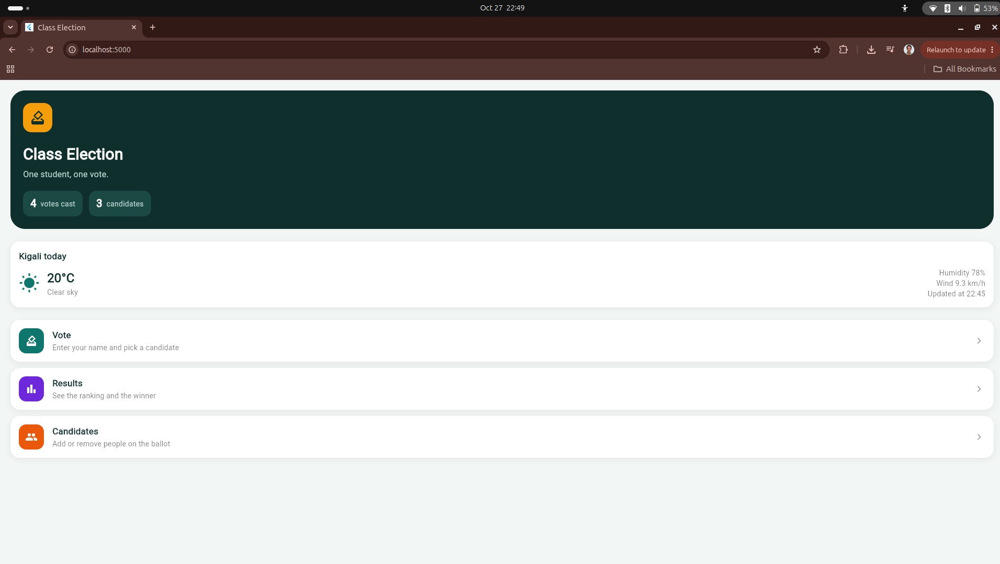
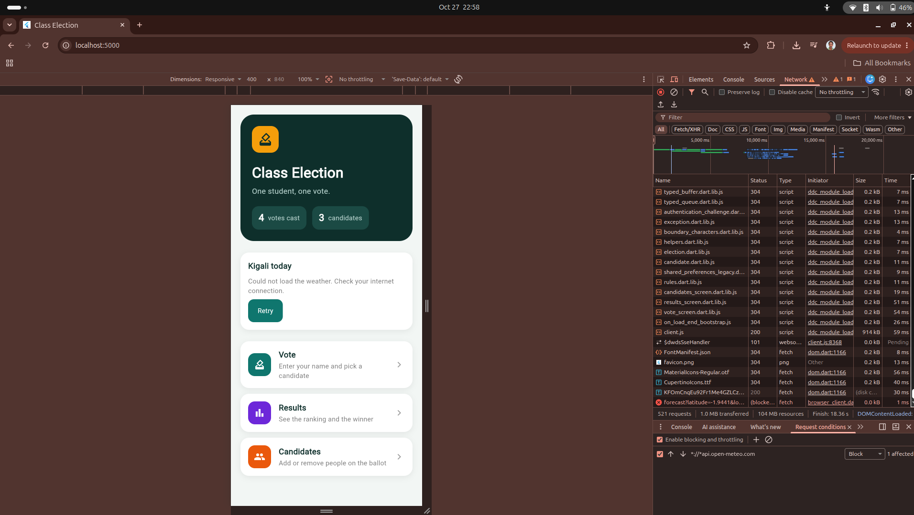

# Class Election

A Flutter app where each student votes once for a candidate. Accounts use Firebase Email/Password authentication, and every account's candidates and voters are stored privately in Cloud Firestore under `users/{uid}/...`. The app also shows today's weather in Kigali from the Open-Meteo API.

## Screenshots

