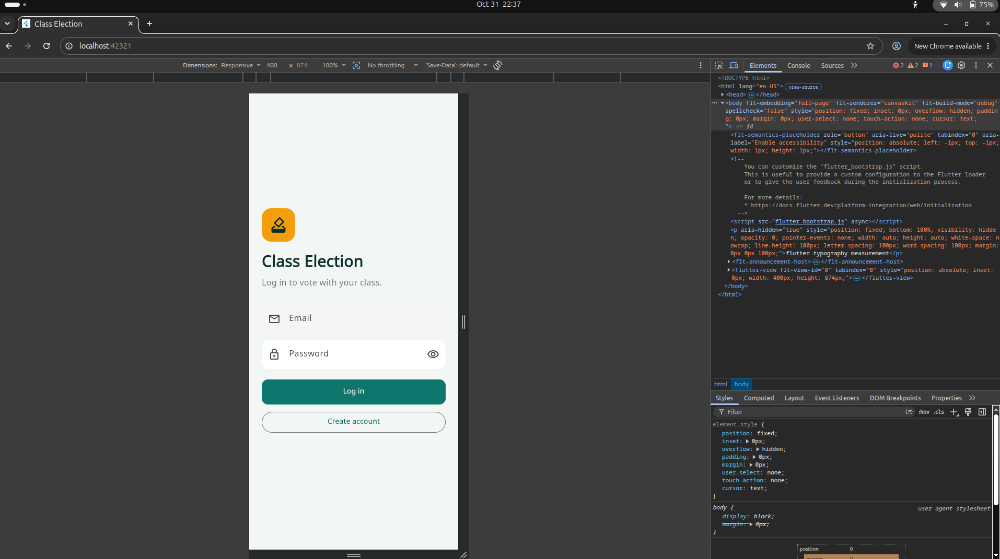
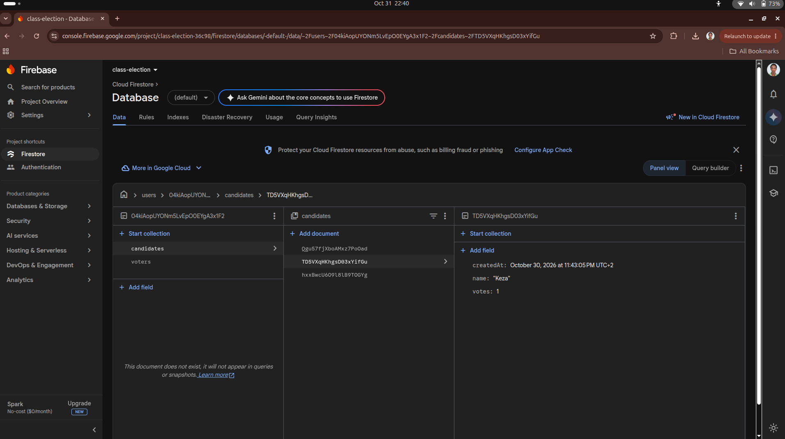
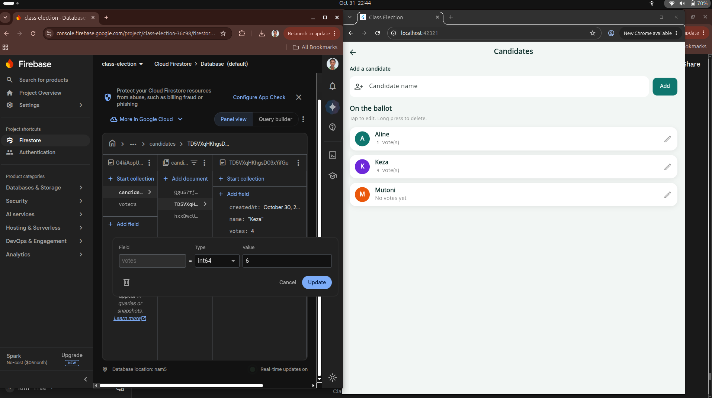
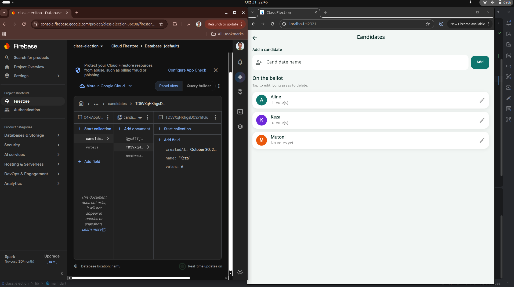
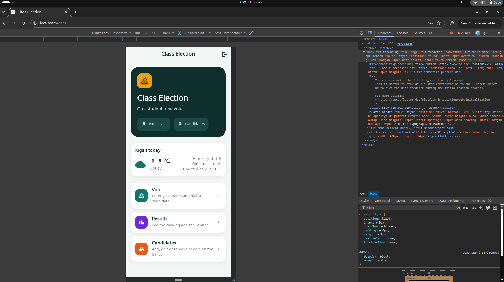

cd ~/Desktop/Mobile/class_election
cat > README.md <<'EOF'
# Class Election

A Flutter app where each student votes once for a candidate. It signs users in with Firebase Authentication, and each user's data is saved in Cloud Firestore under their own id, so two accounts never see each other's data, and every change appears live.

Tested on Chrome (web).

## Screenshots

EOF
